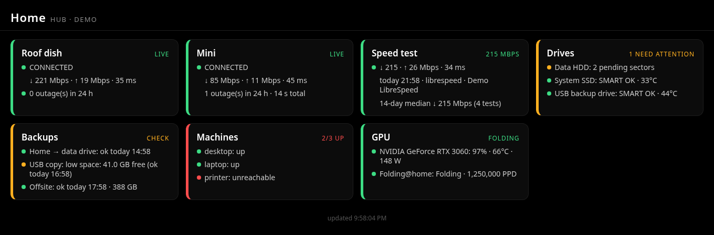

# homehub

A small, self-hosted dashboard for a home network: satellite internet, speed tests, drive health, backups,
machines, GPU / Folding@home, push alerts and an optional AI "what's wrong?" button. One Python process,
standard library only, one `config.json`, no cloud account.



*Screenshot: `--demo` mode, fictional data.*

> Unofficial, community project. Not affiliated with or endorsed by SpaceX/Starlink, Ookla, NVIDIA,
> Folding@home, ntfy or xAI. All product names are their owners' trademarks.

## Try it (no hardware needed)
```bash
git clone https://github.com/jasondmillwood/homehub && cd homehub
python3 -m homehub --demo --port 8099      # open http://localhost:8099
```

## Install (Linux, systemd)
```bash
curl -fsSL https://raw.githubusercontent.com/jasondmillwood/homehub/v0.1.0/install.sh -o install.sh
less install.sh                            # read it first
bash install.sh --dry-run --modules starlink,drives,backups
bash install.sh --modules starlink,drives,backups
```
The installer runs as **your user**: code in `~/.local/share/homehub/app`, config in `~/.config/homehub/config.json`
(mode 600), a user systemd unit `homehub.service`. It writes a random hub token and, if alerts are on, a
random ntfy topic. `--uninstall` removes the service and code; `--uninstall --purge` also deletes config, data and state.

Only one step needs root, `--smart` (SMART collection). It prints the exact commands and asks
`Run these commands with sudo? [y/N]` before doing anything.

Requirements: Python 3.10+, `curl`. Optional: `smartmontools`, `nvidia-smi`, a speed-test CLI, dish-monitor.

## Modules
Every module is optional. A disabled module draws no tile and starts no background job.

| Module | Default | What it shows | Needs |
|---|---|---|---|
| `starlink` | on | one tile per dish: online/away, latency, drops, outages; keeps minute history | [dish-monitor](https://github.com/jasondmillwood/dish-monitor) at `monitor_url` (`install.sh --with-dish-monitor` installs v0.1.0) |
| `drives` | on | SMART health, temperature, reallocated/pending sectors, growth over 7 days, drive events | `smartctl` dumps (`install.sh --smart`) |
| `speedtest` | off | scheduled down/up/ping, history | LibreSpeed CLI (default) or Ookla CLI |
| `backups` | off | last run, age, failures, free space, last integrity check, missed timers | your backup job writes a status JSON (`scripts/backup-status.sh`) |
| `machines` | off | TCP/ping reachability plus optional pushed health (any OS) | nothing |
| `gpu` | off | `nvidia-smi` load/temp/power; Folding@home status and PPD | NVIDIA driver; F@H v8 client (optional) |
| `alerts` | off | ntfy push on problems, reminders, recovery, quiet hours | an ntfy topic (ntfy.sh or self-hosted) |
| `explain` | off | a button that asks xAI's Grok to explain current problems | an xAI API key file |

## Configuration
`config.example.json` documents every key. Start from it, or let the installer write one.

- **`site`**: `title`, `subtitle`, `port`, `bind`. Env overrides: `HOMEHUB_PORT`, `HOMEHUB_BIND`, `HOMEHUB_DEMO=1`.
- **`network.allowed_nets`**: client networks allowed to connect at all (CIDR list).
- **`paths`**: sqlite `db`, `state_dir`, `status_dir` (where push endpoints and backup jobs write status JSON).
- **`secrets`**: **file paths only**: `hub_token_file`, `ntfy_token_file`, `xai_api_key_file`. Keep them mode 600.
- **`modules.<name>.enabled`** plus each module's settings, as in the example.

Check a config without starting: `python3 -m homehub --config ~/.config/homehub/config.json --check`.

### Drives: per-device overrides
`modules.drives.devices` is keyed by serial number: `label`, `hot_c`, `stale_after_s`, `usb_sleep_safe`.

### Sleep-safe USB SMART
A USB backup drive that sleeps most of the day shouldn't be woken just to read SMART. Read it right after the
backup instead, while it is still spinning, with a drop-in on your backup service:
```ini
# sudo systemctl edit my-backup.service
[Service]
ExecStopPost=+/usr/local/sbin/smart-dump-usb /dev/disk/by-id/usb-YOUR_DRIVE
```
`smart-dump-usb` uses `smartctl -n standby` (never spins the drive up), never mounts anything, always exits 0,
and skips the dump if the drive is already asleep. Then set `"usb_sleep_safe": true` for that serial so the
tile allows a 26-hour gap instead of 2 hours. Dumps taken while a drive sleeps never replace the last good reading.

### Backups: status-file contract
Each job writes `status_dir/<status_file>`:
```json
{"start": 1700000000, "end": 1700000600, "ok": true, "rc": 0, "step": "backup", "msg": "",
 "driveFreeBytes": 412000000000, "mounted": true, "checkRan": true, "checkOk": true}
```
Only `end` and `ok` are required. `scripts/backup-status.sh` wraps any command and writes it for you; another
machine can `POST /api/backups/push?job=<id>` with the hub token. `systemd_timer` on a job flags missed runs.

### Speed test: LibreSpeed or Ookla
LibreSpeed CLI (LGPL-3.0, open source) is the default; the installer downloads the 1.0.14 release and checks
its sha256. The Ookla CLI is proprietary: the installer shows Ookla's license and privacy links and only
downloads it after you type `accept` at a terminal, and the config needs `"ookla_license_accepted": true`.
Neither is bundled.

### Machines on other operating systems
v0.1.0 ships Linux helper scripts only. Any machine (Windows, macOS, a NAS) can still report by POSTing JSON
to `/api/machines/push?host=<name>` with the `X-Hub-Token` header, e.g. `{"ts": 1700000000, "disk_free_pct": 41}`.

## API
Read-only: `GET /api/health`, `/api/modules`, `/api/tiles`, plus each module's `/api/<module>...`.
State-changing requests need the hub token (`X-Hub-Token`) or the dashboard session plus a same-origin request.

## Security
Run it on a trusted LAN or private VPN; never forward its port. See [SECURITY.md](SECURITY.md).

## License
MIT, see [LICENSE](LICENSE). External programs it can call are listed in [THIRD_PARTY_LICENSES](THIRD_PARTY_LICENSES).
